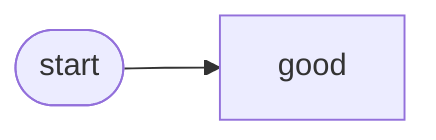

# Unit test

unit test => integration test => E2E

## unit test:
 - gyors
 - automatikusan futtathato
 - izolalhato - fuggetlen
    - mock (tobbet tud)
    - stub

## Integration test
 - lasubb
 - hogyan mukodnek egyutt a moduljaink
 - pls: 
    - kod + DB
    - kod + API
<table>
    <tr>
        <th></th>
        <th>Unit</th>
        <th>Integration</th>
    </tr>
    <tr>
        <td>mit vizsgal?</td>
        <td>Egyetlen fgv/methodus</td>
        <td>tobb modul egyuttmukodese</td>
    </tr>
    <tr>
        <td>Kulso fuggoseg</td>
        <td>Nincs (mockolva van)</td>
        <td>van (pl DB, API)</td>
    </tr>
    <tr>
        <td>sebesseg</td>
        <td>nagyon gyors</td>
        <td>lasabb (halozati I/O)</td>
    </tr>
    <tr>
        <td>Ki irja</td>
        <td> szoftvertesztelo</td>
        <td>fejleszto vagy tesztelo</td>
    </tr>
 
</table>

<table>
    <tr>
        <th>Rendszerteszt</th>
        <th>Atadasi/Atveteli teszt</th>
    </tr>
    <tr>
        <td>E2E: End to End</td>
        <td>Acceptance testing</td>
    </tr>
    <tr>
        <td>nem functios</td>
        <td>UAT (user acceptance test)</td>
    </tr>
    <tr>
        <td>lassu</td>
        <td>alfa/beta testing <br>
            - fejlesztok <br> 
            - felhasznalok egy csoportja</td>
    </tr>
    <tr>
        <td>Staging</td>
        <td>OAT Mukodesi/uzelmeltetesi <br>
            - rendszergazdak</td>
    </tr>
    <tr>
        <td>Cel: hibak feltarasa <br>
            - helyi mernokok</td>
        <td>Cel: uzleti alkalmassag vizsgalata <br>
        - megrendelok</td>
    </tr>
</table>

```text
           / \
          /   \
         /unit \
        /-------\
       /   int.  \
      /-----------\
     /     E2E     \
    /---------------\
```
# Icecream cone anti pattern
 - lassu visszajelzes
 - draga karbantartas
 - nahezen behatarolhato hibak

